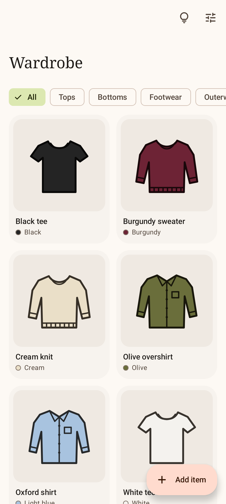
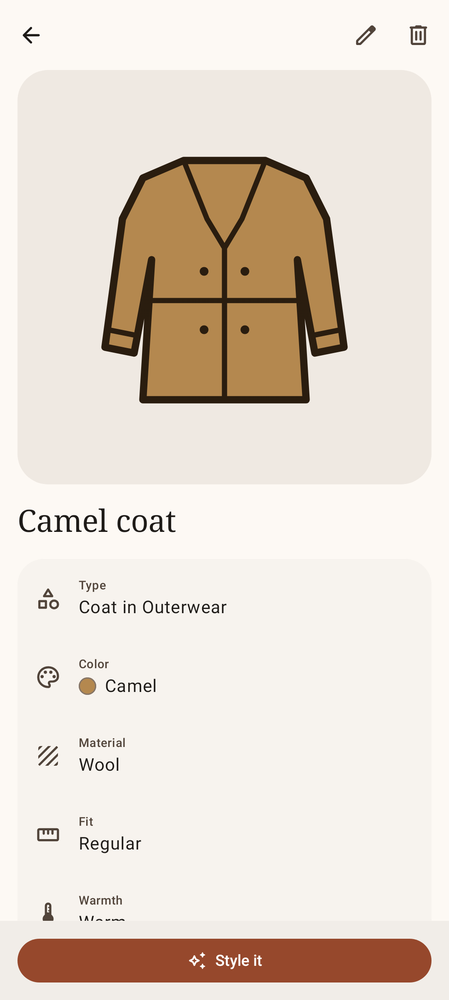
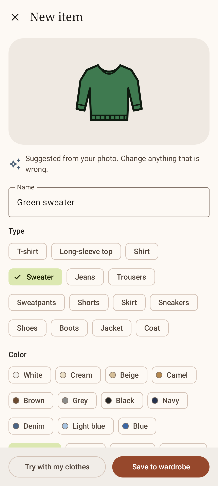
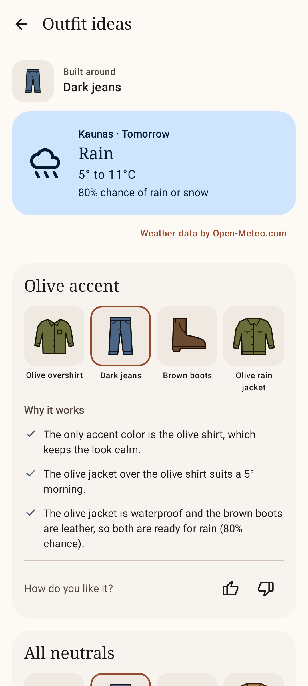

# Clankdrobe

Android app. Catalog of the clothes you own, outfit suggestions built from it.

Status: milestone 3 in progress. Items are stored on the phone, starting with 17 sample items. Photo recognition runs on the phone. The forecast comes from Open-Meteo.

| Wardrobe | Item | Add item | Outfit ideas |
|---|---|---|---|
|  |  |  |  |

## Requirements

- JDK 17
- Android SDK Platform 37: `sdkmanager "platforms;android-37.0"`
- Device or emulator with Android 8.0 (API 26) or newer. Portrait only.

## Build and run

```
./gradlew assembleDebug     # build app/build/outputs/apk/debug/app-<abi>-debug.apk
./gradlew installDebug      # install on the connected device
./gradlew installRelease    # install the minified build, for demos
```

The build makes one APK per processor type, and the install tasks pick the device's. The release build is shrunk with R8 (arm64 about 19 MB, most of it ML Kit's native code and the image model) and signed with the local debug key, so it installs over the debug build. Not for publishing.

## Use

| Screen | Actions |
|---|---|
| Wardrobe tab | Category chips. Filter icon: colors, seasons. Lightbulb: What to add. Tap a card for details. Add item button. |
| Item | Edit. Delete, with Undo on the snackbar. Style it: outfit ideas for this item, today. |
| Add item | Take a photo or Choose from gallery, then confirm the suggested type and color, set material, fit, warmth and seasons, Save. Try with my clothes: see what it would do for your wardrobe without saving it. |
| Outfits tab | Pick a day and an item, Show outfits. Like or dislike each outfit. The History button lists rated outfits, or the liked ones as a gallery. |
| Settings tab | Theme: System, Light, Dark. Location: search for the forecast's city with Open-Meteo's place search. Taste profile: the color and garment pairs your ratings taught, Start over. Remove sample items, while any are left. |

## Prototype limits

| Feature | Now |
|---|---|
| Storage | Room database on the phone. The first launch adds the 17 sample items, and Settings can remove them. Uninstalling the app or clearing its data deletes everything, and there is no export yet. |
| Photos | Taken with the phone's camera app or picked from the gallery, kept at full size in app storage. Items show the cut-out of their photo, or the photo itself when it has none. Sample items show drawings. |
| Photo recognition | On the phone. A clothes model trained for the app (`tools/train_garment_model.py`) suggests the type, from whichever of the photo and its cut-out it is surer about. ML Kit's subject segmentation (beta, downloaded by Google Play services) makes the cut-out. An ImageNet model splits its pants, shoes and outerwear classes. ML Kit's standard labels (Google Play services downloads that model on first use) suggest wool, and decide the type when the clothes model is unsure. They don't tell denim apart, so jeans need ImageNet's "jean" label and usually come out as trousers. When no model is sure of the type, the form leaves it for you to pick. The clothes model's boots class learned from 55 hand-sorted photos, so it finds some boots and calls some dark leather shoes boots. The color comes from the cut-out, or from the middle of the photo when there is none. Sweatpants are suggested as trousers, long-sleeve tops as sweaters and shoes as sneakers or boots, since the clothes model has no such classes. `adb logcat -s MlKitRecognizer RoomWardrobeRepository` shows the raw labels, the suggestion and what was saved. |
| Outfits | Built by rules from the wardrobe and the day's forecast, three per item, and three more each time you tap More outfits. On drizzle days a wool top gets a jacket over it. Past suggestions don't change later ones, but ratings do. |
| Weather | 7-day forecast for the chosen city, Kaunas by default, from [Open-Meteo](https://open-meteo.com/) (free for non-commercial use, data CC BY 4.0). Fetched at app start and on the Outfits tab when the saved one is over an hour old. The last forecast stays on the phone for offline use. Without one, the Outfits screens ask to retry. Drizzle under 1 mm a day counts as cloudy. Celsius only. |
| Store check | Try with my clothes on the Add item form. Shows how many of your items would have it in their top three outfits, the items it nearly repeats, and its best outfit for a hot, mild, cool and cold day. Nothing is saved unless you press Save. |
| What to add | For each category, the garment and colors you don't have that the outfit rules would pick with the most of your items, judged on four fixed dry days (hot, mild, cool, cold). Takes a few seconds. A color close to one you have in that garment is skipped. |
| Likes | Saved on the phone. A rated outfit gets 2 points up or down. Other outfits get up to 2 points from the color and garment pairs of the top, bottoms and shoes they share with rated ones. A rating reorders the outfits at once. Taste learns only from outfits you were shown. Start over makes older ratings stop counting, and History keeps them. |

## Test

```
./gradlew testDebugUnitTest      # unit and Compose UI tests (Robolectric)
./gradlew verifyRoborazziDebug   # same, plus screenshot comparison
./gradlew recordRoborazziDebug   # re-record screenshots after an intended UI change
./gradlew lintDebug
./gradlew connectedDebugAndroidTest   # on an emulator: installs, tests, then uninstalls the app and its data
```

- Reference screenshots: `app/src/test/screenshots/`
- Device tests: `app/src/androidTest/`. A fresh install is expected (sample items), so run them on an emulator, not a phone with your own wardrobe.
- Database schemas, one file per version: `app/schemas/`. The debug build packs them as assets for `WardrobeMigrationTest`.
- CI: `.github/workflows/ci.yml` runs `assembleDebug assembleRelease verifyRoborazziDebug lintDebug` on every push to `main` and on pull requests.

## Code

```
app/src/main/java/app/wardrobe/
  AppContainer.kt         shared objects: repository, recognizer, forecast, theme
  data/                   repository (Room, and in memory for tests), sample data, stand-in recognizer
  domain/model/           items, colors, forecast
  domain/engine/          outfit rules, scoring and reasons, taste from ratings, wardrobe gaps, store check
  feature/wardrobe/       grid and filters
  feature/item/           detail, add, edit
  feature/outfits/        generator, results, outfit titles and reason sentences
  feature/history/        rated outfits and the liked gallery
  feature/taste/          taste profile, Start over
  feature/gaps/           What to add
  feature/store/          store check
  feature/settings/       settings, location search
  navigation/             routes, back stacks per tab, app shell
  ui/                     theme, shared components, labels
tools/
  theme_palette.py        generates ui/theme/Color.kt, checks WCAG AA contrast
  install_icon.py         imports a Material Symbols icon into res/drawable
```

Screens with data: a ViewModel exposing one `StateFlow` of UI state, and a stateless `...Content` composable that the screenshot tests render. Settings reads the theme and the forecast's place from `AppContainer`.

## Stack

Kotlin 2.4.21, Jetpack Compose (BOM 2026.09.00), Material 3, Navigation 3 1.2.0, Room 2.8.5 with KSP 2.3.12, Coil 3.6.3, ML Kit image labeling 16.0.8 and custom image labeling 17.0.3, AGP 9.4.1, Gradle 9.8.2. Tests: JUnit 4, Robolectric 4.17, Roborazzi 1.77.0.

Icons: Material Symbols, Apache License 2.0. Image model `app/src/main/assets/models/imagenet_efficientnet_lite0_int8.tflite`: EfficientNet-Lite0 int8 by TensorFlow, from tensorflow/efficientnet on Kaggle, Apache License 2.0. Clothes model `garments_mobilenetv2_int8.tflite`: trained by `tools/train_garment_model.py` on the clothing dataset by Alexey Grigorev (github.com/alexeygrigorev/clothing-dataset, CC0 1.0), starting from Keras 3.15.1's MobileNetV2 ImageNet weights (Keras: Apache License 2.0).
