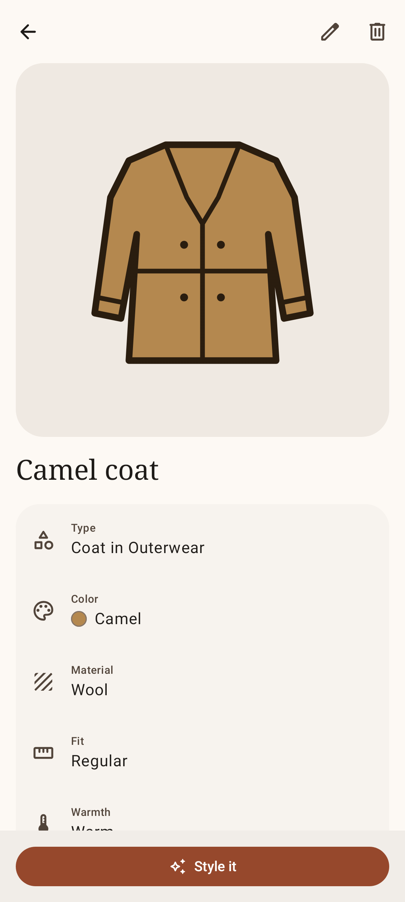
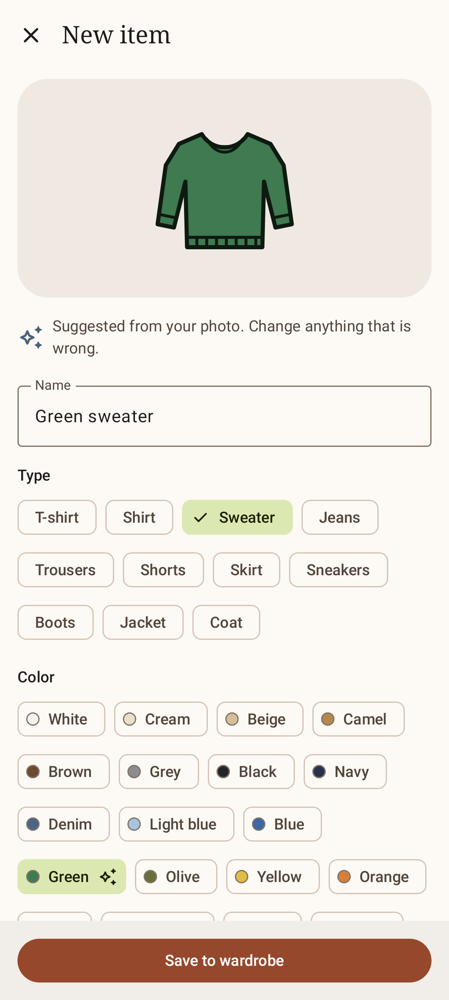
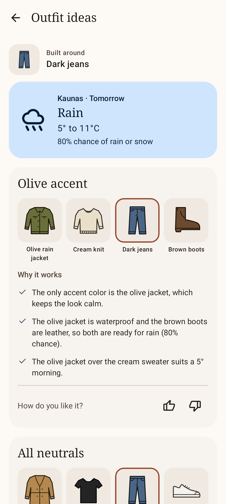

# Clankdrobe

Android app. Catalog of the clothes you own, outfit suggestions built from it.

Status: milestone 2 in progress. Items are stored on the phone, starting with 17 sample items. Weather and photo recognition are still samples.

| Wardrobe | Item | Add item | Outfit ideas |
|---|---|---|---|
|  |  |  |  |

## Requirements

- JDK 17
- Android SDK Platform 37: `sdkmanager "platforms;android-37.0"`
- Device or emulator with Android 8.0 (API 26) or newer. Portrait only.

## Build and run

```
./gradlew assembleDebug     # build app/build/outputs/apk/debug/app-debug.apk
./gradlew installDebug      # install on the connected device
./gradlew installRelease    # install the minified build, for demos
```

The release build is shrunk with R8 (about 1.9 MB, debug about 13 MB) and signed with the local debug key, so it installs over the debug build. Not for publishing.

## Use

| Screen | Actions |
|---|---|
| Wardrobe tab | Category chips. Filter icon: colors, seasons. Tap a card for details. Add item button. |
| Item | Edit. Delete, with Undo on the snackbar. Style it: outfit ideas for this item, today. |
| Add item | Take a photo or Choose from gallery, then confirm the suggested type and color, set material, fit, warmth and seasons, Save. |
| Outfits tab | Pick a day and an item, Show outfits. Like or dislike each outfit. |
| Settings tab | Theme: System, Light, Dark. |

## Prototype limits

| Feature | Now |
|---|---|
| Storage | Room database on the phone. The first launch adds the 17 sample items. |
| Photos | Taken with the phone's camera app or picked from the gallery, kept at full size in app storage. Sample items show drawings. |
| Photo recognition | Ignores the photo. Returns green sweater, red sneakers, navy coat, in turn. |
| Outfits | Built by rules from the wardrobe and the day's sample weather, up to three per item. No memory of past suggestions yet. |
| Weather | Fixed sample week for Kaunas, starting today. Celsius only. |
| Likes | Kept until the results screen closes. |
| Theme | Kept until the app restarts. |

## Test

```
./gradlew testDebugUnitTest      # unit and Compose UI tests (Robolectric)
./gradlew verifyRoborazziDebug   # same, plus screenshot comparison
./gradlew recordRoborazziDebug   # re-record screenshots after an intended UI change
./gradlew lintDebug
```

- Reference screenshots: `app/src/test/screenshots/`
- Database schemas, one file per version: `app/schemas/`. The debug build packs them as assets for `WardrobeMigrationTest`.
- CI: `.github/workflows/ci.yml` runs `assembleDebug assembleRelease verifyRoborazziDebug lintDebug` on every push to `main` and on pull requests.

## Code

```
app/src/main/java/app/wardrobe/
  AppContainer.kt         shared objects: repository, recognizer, forecast, theme
  data/                   repository (Room, and in memory for tests), sample data, stand-in recognizer
  domain/model/           items, colors, forecast
  domain/engine/          outfit rules, scoring and reasons
  feature/wardrobe/       grid and filters
  feature/item/           detail, add, edit
  feature/outfits/        generator, results, outfit titles and reason sentences
  feature/settings/       settings
  navigation/             routes, back stacks per tab, app shell
  ui/                     theme, shared components, labels
tools/
  theme_palette.py        generates ui/theme/Color.kt, checks WCAG AA contrast
  install_icon.py         imports a Material Symbols icon into res/drawable
```

Screens with data: a ViewModel exposing one `StateFlow` of UI state, and a stateless `...Content` composable that the screenshot tests render. Settings reads the theme from `AppContainer`.

## Stack

Kotlin 2.4.21, Jetpack Compose (BOM 2026.09.00), Material 3, Navigation 3 1.2.0, Room 2.8.5 with KSP 2.3.12, Coil 3.6.3, AGP 9.4.1, Gradle 9.8.1. Tests: JUnit 4, Robolectric 4.17, Roborazzi 1.76.0.

Icons: Material Symbols, Apache License 2.0.
